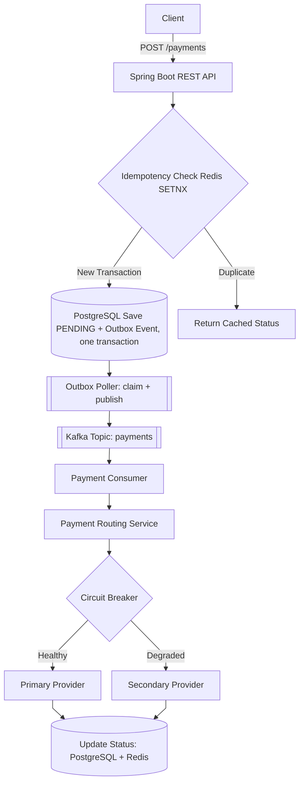
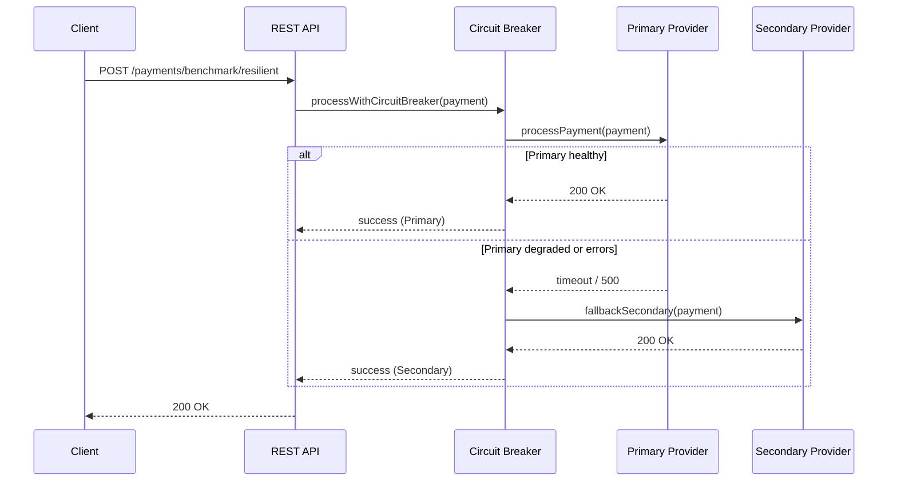

# Resilient Payment Gateway

A distributed payment processing backend that stays available and correct when a downstream payment provider degrades or fails — built with Java, Spring Boot, Kafka, Redis, PostgreSQL, Resilience4j, and Micrometer/Prometheus/Grafana for observability.

## The Problem

Every payment platform depends on a third-party processor (Stripe, Adyen, etc.) that can time out, throttle, or go down entirely. A naive integration lets that outage become the customer's problem: failed checkouts, lost revenue, and duplicate charges when retries aren't handled safely.

This project builds a payment gateway that detects a degrading provider automatically, reroutes live traffic to a healthy secondary provider before customers notice, guarantees each transaction reaches Kafka exactly once even if the process crashes mid-write, and prevents duplicate charges under concurrent retries — then proves all three properties under escalating load, not just unit tests.

## Architecture



The diagram above shows the system's components and how data moves between them — including the transactional outbox step between the database write and Kafka, which closes the dual-write gap a naive "save then publish" implementation leaves open. The sequence below zooms into a single request, showing what happens in the few hundred milliseconds after a payment is submitted — specifically, how the circuit breaker decides whether to trust the primary provider or reroute instantly to the secondary.

### Failover Flow



## Key Engineering Highlights

- **Automatic failover** — a Resilience4j circuit breaker wraps the primary provider call; on repeated failures or slow responses, traffic reroutes to a secondary provider without the caller ever seeing an error.
- **Transactional outbox** — the payment row and its outbox event are written atomically in the same database transaction, so a crash between "save payment" and "publish to Kafka" can never silently lose an event. A separate poller claims and publishes outbox rows on a schedule, using an atomic `UPDATE ... WHERE status = 'PENDING'` so multiple app instances can never double-publish the same event.
- **Bounded retries** — failed Kafka publishes are retried up to a configured ceiling before being marked `FAILED` for manual review, instead of retrying forever or silently dropping.
- **Dual-layer idempotency** — a Redis `SETNX` lock (with a 24-hour TTL) catches duplicate submissions cheaply and fast; a PostgreSQL unique constraint on `transaction_id` is the backstop of last resort if Redis were ever unavailable.
- **Cache-aside status lookups** — payment status reads hit Redis first, falling back to PostgreSQL (and repopulating the cache) if the entry has expired or was never cached.
- **Full observability** — circuit breaker state, call outcomes, request latency, and outbox queue depth are all instrumented via Micrometer and exposed to Prometheus, visualized in a live Grafana dashboard (see below).

## Benchmark: Baseline vs. Resilient (Circuit Breaker Isolation Test)

Load tested with [`hey`](https://github.com/rakyll/hey) (100 requests, concurrency 10) against a primary provider configured to fail ~15% of the time with a 400ms hang before erroring.

| Metric | Baseline (single provider) | Resilient (circuit breaker + failover) |
|---|---|---|
| Successful responses | 89 / 100 | **100 / 100** |
| Failed responses (500) | 11 | **0** |
| p50 latency | 158 ms | 109 ms |

The resilient path recovers every transaction the baseline would have dropped, with no successful requests lost to a degraded provider.

> **On circuit breaker state:** at a realistic ~15% failure rate, the breaker's per-request fallback does the recovery work shown above — the breaker itself stays `CLOSED`, since failures don't reliably cross the 50% threshold within a 10-request sliding window at that rate. The `CLOSED → OPEN → HALF_OPEN` state machine was separately validated under an elevated fault-injection rate (a temporary 60% override), confirming the breaker correctly trips and recovers when a provider is severely degraded, not just intermittently flaky.

## Full-System Load Testing (Redis + PostgreSQL + Outbox + Kafka)

Beyond the isolated circuit breaker benchmark above, the complete pipeline — idempotency lock, transactional outbox, poller, Kafka, and consumer — was validated end to end via a custom load-testing dashboard, at escalating scale and concurrency, with results verified directly against PostgreSQL rather than trusting API responses alone.

**Duplicate-charge prevention**, tested by firing many concurrent requests carrying the *same* transaction ID:

| Concurrent duplicate requests | Accepted as new | Caught as duplicate | Errors |
|---|---|---|---|
| 10 | 1 | 9 | 0 |
| 50 | 1 | 49 | 0 |
| 100 | 1 | 99 | 0 |

Verified in every trial with a direct database check (`SELECT COUNT(*) FROM payments WHERE transaction_id = '...'`), confirming exactly one row was ever created — not just that the API returned the expected status codes.

**End-to-end completion**, tested by submitting unique transactions through the real `POST /payments` path and tracking how many reach a terminal state:

- A 500-transaction burst reached **100% completion with zero data loss**.
- A 1,000-transaction burst did not complete within the initial observation window, but a direct PostgreSQL query after the fact confirmed **100% of transactions eventually reached `APPROVED` with zero lost or stuck records**. The gap between the two runs pointed to a real, specific bottleneck: the Kafka consumer processes messages sequentially on a single partition, so throughput does not scale linearly with load once per-message processing time becomes the binding constraint. This is a genuine finding, not a failure — it surfaces a concrete scaling path (topic partitioning + consumer concurrency) that would matter at real production volume.

## Observability

Circuit breaker state, call outcomes, request latency, and outbox queue depth are exposed via Spring Boot Actuator + Micrometer and scraped by Prometheus on a 5-second interval, visualized in Grafana:


A companion local HTML dashboard (`resilience-dashboard.html`) drives test traffic directly against the running application — single test transactions, configurable large-scale bursts, full end-to-end completion tests, and concurrent duplicate-request stress tests — so the system's behavior can be observed and triggered live rather than only inferred from logs.

## Tech Stack

| Layer | Technology |
|---|---|
| Language | Java 21 |
| Framework | Spring Boot 4 |
| Messaging | Apache Kafka |
| Cache | Redis |
| Database | PostgreSQL |
| Resilience | Resilience4j (Circuit Breaker) |
| Observability | Spring Boot Actuator, Micrometer, Prometheus, Grafana |
| Containerization | Docker Compose |
| Load Testing | hey, custom load-testing dashboard |

## Getting Started

```bash
# Start Postgres, Redis, Kafka, Prometheus, and Grafana
docker-compose up -d

# Run the application
./mvnw spring-boot:run
```

Open `resilience-dashboard.html` directly in your browser to drive test traffic and watch circuit breaker state, outbox queue depth, and live transaction results.

Grafana: `http://localhost:3000` (default admin/admin on first run). Prometheus: `http://localhost:9090`.

Initiate a payment (async, via the outbox and Kafka):
```bash
curl -X POST http://localhost:8080/api/v1/payments \
  -H "Content-Type: application/json" \
  -d '{"transactionId":"txn-001","userEmail":"user@example.com","amount":49.99,"currency":"USD"}'
```

Check status:
```bash
curl http://localhost:8080/api/v1/payments/txn-001
```

Run the baseline vs. resilient circuit breaker benchmark directly:
```bash
curl -X POST http://localhost:8080/api/v1/payments/benchmark/baseline -H "Content-Type: application/json" -d '{"transactionId":"bench-001"}'
curl -X POST http://localhost:8080/api/v1/payments/benchmark/resilient -H "Content-Type: application/json" -d '{"transactionId":"bench-002"}'
```

## Project Structure

```
src/main/java/com/pay/paymentgateway/
├── config/            → CorsConfig, OutboxMetricsConfig (custom Micrometer gauges)
├── consumer/          → Kafka consumer, drives the routing decision
├── controller/        → REST endpoints, OutboxStatusController
├── dto/               → ProviderResponse
├── entity/            → Payment, PaymentStatus, OutboxEvent, OutboxStatus
├── provider/          → PaymentProvider interface, Primary/Secondary implementations
├── repository/        → PaymentRepository, OutboxRepository (JPA)
└── service/           → PaymentService (idempotency), PaymentPersistenceService (atomic save),
                         PaymentRoutingService (circuit breaker), OutboxPoller (publish + retry)
```

## Roadmap

- [ ] Enforced payment state machine (e.g., blocking a refund on a `PENDING` or `DECLINED` transaction)
- [ ] Kafka topic partitioning + consumer concurrency, addressing the throughput bottleneck surfaced by the 1,000-transaction load test
- [ ] `SELECT ... FOR UPDATE SKIP LOCKED` as a more granular alternative to the current bulk-`UPDATE` outbox claiming strategy
- [ ] k6-based load testing for properly concurrent, percentile-reported benchmarks beyond the current browser-driven dashboard tests

## License

MIT
